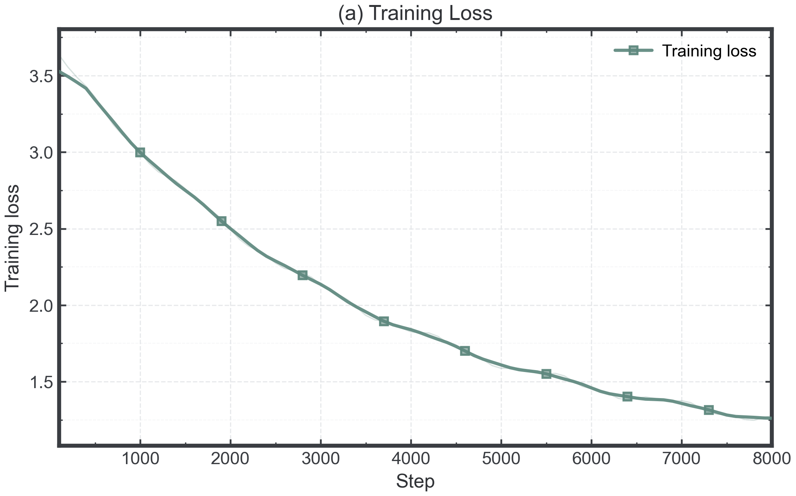
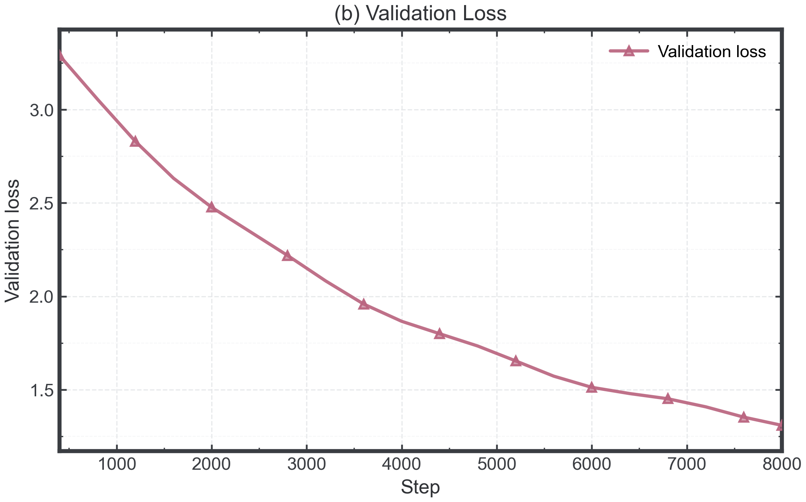
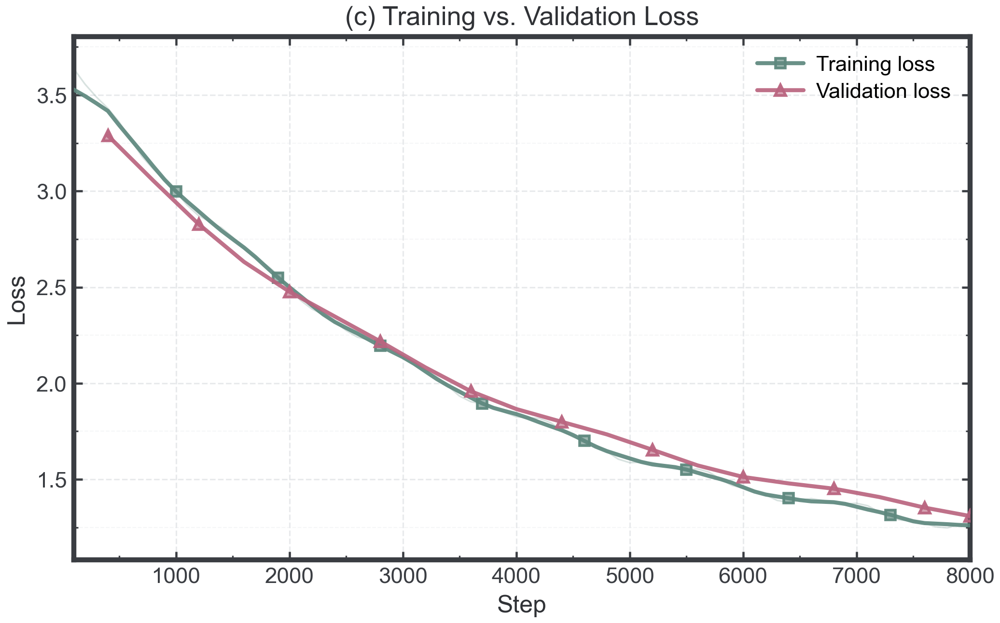
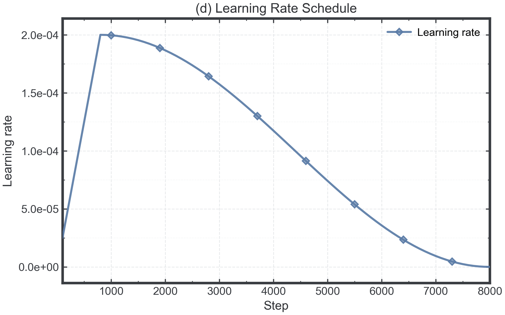
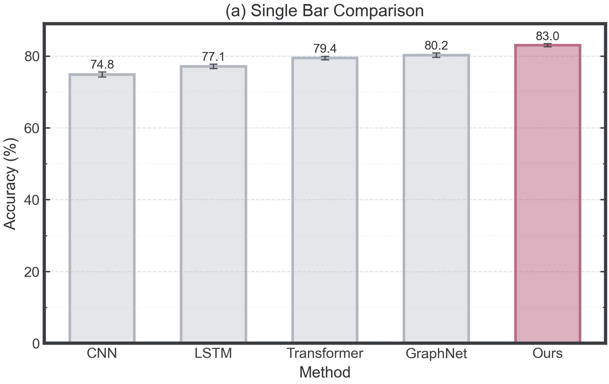
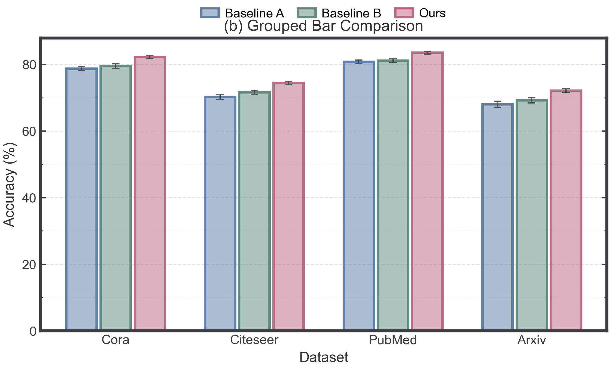
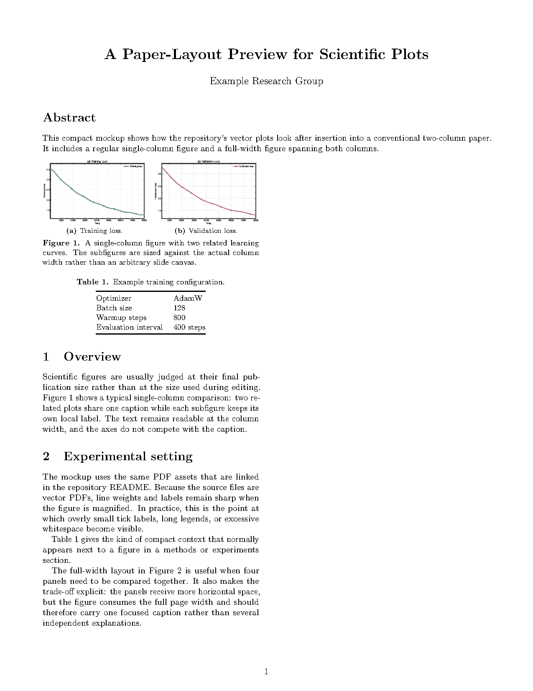
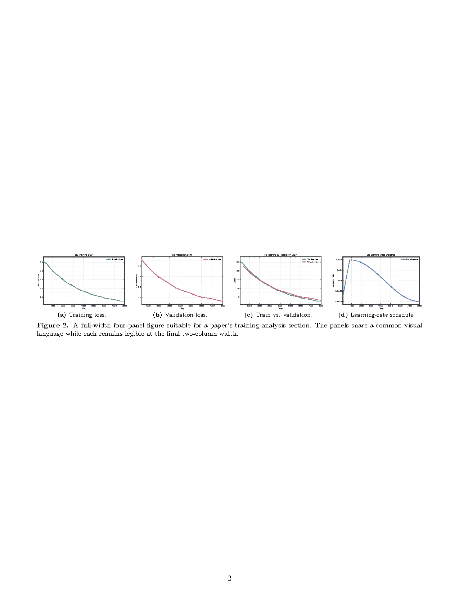

# My Codex Skills

<p align="center">
  <a href="README.md"><strong>English</strong></a>
  ·
  <a href="README.zh-CN.md"><strong>中文</strong></a>
</p>

This repository contains my custom Codex skills for creating polished, configurable scientific plots, reading English research papers, and organizing reproducible research code projects.

## Skills

### `plot-training-curves`

Create configurable line plots for LLM and machine-learning training logs, including:

- Training loss
- Validation loss
- Training vs. validation loss
- Learning-rate schedule

The skill emphasizes reusable plotting code with explicit config interfaces for figure size, colors, line styles, alpha, markers, titles, labels, legends, ticks, grids, and export settings.
Its default plots use a complete `2.5 pt` axes frame, `2.0 pt` main curves, and slightly stronger marker edges.
Each run also saves full-precision unsmoothed chart data, a JSON config, and a standalone plot script next to the image. Edit the config and rerun that script to redraw without the original training log.

### `plot-bar-charts`

Create configurable single and grouped bar charts for scientific comparisons, including:

- Single bar charts
- Highlighted-method bar charts
- Grouped bar charts
- Error bars and value labels

The skill also requires generated bar-plot code to expose config controls for bar width, colors, alpha, edge style, error bars, value labels, legend placement, axis settings, and export formats.
Its default plots use a complete `2.5 pt` axes frame and `2.0 pt` bar outlines.
It saves chart-ready values and uncertainties as CSV alongside a JSON config and standalone plot script. Duplicate or missing comparison values now fail explicitly instead of being silently replaced.

### `paper-reading`

Read an attached English research paper and produce an evidence-grounded Chinese explanation for a reader who knows basic machine learning but not the paper's domain. The skill covers:

- STAR summary of the motivation, task, method, and results;
- exact method reconstruction with equations, symbols, data flow, training, and inference;
- experiment comparisons and tables when relevant to the question and paper type;
- separation of observations, hypotheses, algorithmic consequences, and experimental support;
- limitations, inconsistencies, uncertainty, and the boundary of the conclusions.

It requires important claims and numbers to be tied to paper locations when available, and distinguishes direct evidence, author speculation, reasonable inference, and unreported information.

Full analyses are saved as Markdown (`.md`), with `$...$` for inline math and `$$...$$` for display math. Focused follow-up questions do not rewrite the file unless revision is requested.

### `research-project-workflow`

Build reproducible research and machine-learning workflows covering project layout, coding conventions, experiment execution, and command-by-command guides. The skill connects Conda setup, data preparation, YAML configs, executable entrypoints, run outputs, summaries, and reproducible plots.

It emphasizes a layout proportionate to the project, portable paths, validated configs and temporary CLI overrides, isolated runs and incremental results, explicit statistical definitions, and independent replot bundles. It also separates stable guides from research hypotheses and defines Git boundaries for large assets and private notes.

New configs preferably use `.yaml`. Training progress uses `tqdm` when suitable, non-actionable warnings go to run logs, and terminal status messages use prefixes such as `[INFO]`, `[SUCCESS]`, `[WARNING]`, and `[FAIL]`. Plotting normally runs automatically after training/evaluation completes and can also run independently from saved data and an editable plot config.

A single experiment invocation can run an ordered YAML `seeds` list sequentially, save each seed independently, then export all individual results and cross-seed statistics in Markdown, JSON, and CSV.

Guides use Conda exclusively for Python environment management; pip-only dependencies may be installed with `python -m pip` inside the named Conda environment. Each guide teaches ordered commands for environment verification, datasets/checkpoints, smoke tests, formal experiments, different YAML configurations and supported CLI overrides, result inspection, and independent redraw. Each step states its working directory, prerequisites, and success check.

The guidance is distilled from a real project architecture review. It adapts to existing conventions without requiring empty directories or copying algorithm-specific settings. The skill includes three focused references and UI metadata; it does not need a helper script.

## Examples

Each preview links to the corresponding PDF file.

The preview values are illustrative synthetic data. Regenerate all previews with `python3 assets/examples/generate_examples.py` in an environment with `matplotlib` and `numpy`.

### Training Curves

<table>
  <tr>
    <td align="center" width="50%">
      <a href="assets/examples/training_curves/sample_llm_training_curves_a_train_loss.pdf">
        
      </a>
      <br>
      <strong>(a) Training loss</strong>
    </td>
    <td align="center" width="50%">
      <a href="assets/examples/training_curves/sample_llm_training_curves_b_val_loss.pdf">
        
      </a>
      <br>
      <strong>(b) Validation loss</strong>
    </td>
  </tr>
  <tr>
    <td align="center" width="50%">
      <a href="assets/examples/training_curves/sample_llm_training_curves_c_train_vs_val_loss.pdf">
        
      </a>
      <br>
      <strong>(c) Training vs. validation loss</strong>
    </td>
    <td align="center" width="50%">
      <a href="assets/examples/training_curves/sample_llm_training_curves_d_lr_schedule.pdf">
        
      </a>
      <br>
      <strong>(d) Learning-rate schedule</strong>
    </td>
  </tr>
</table>

### Bar Charts

<table>
  <tr>
    <td align="center" width="50%">
      <a href="assets/examples/bar_charts/sample_bar_single.pdf">
        
      </a>
      <br>
      <strong>Single highlighted bar chart</strong>
    </td>
    <td align="center" width="50%">
      <a href="assets/examples/bar_charts/sample_bar_grouped.pdf">
        
      </a>
      <br>
      <strong>Grouped bar chart</strong>
    </td>
  </tr>
</table>

### Paper-layout mockup

The repository also includes a two-page paper-layout preview that embeds the
same vector PDFs in a realistic two-column manuscript. It demonstrates a
single-column two-panel figure, a full-width four-panel `figure*`, subfigure
labels, captions, body-text references, and the final-size relationship between
plots and surrounding content.

<p align="center">
  <a href="assets/examples/paper_layout/paper_layout_demo.pdf">
    
  </a>
  <a href="assets/examples/paper_layout/paper_layout_demo.pdf">
    
  </a>
</p>

The source is [`assets/examples/paper_layout/paper_layout_demo.tex`](assets/examples/paper_layout/paper_layout_demo.tex). From that directory, rerun it with:

```bash
latexmk -pdf paper_layout_demo.tex
```

### Research Project Workflow

For a machine-learning study with a baseline, a parameter sweep, and multiple seeds, a typical resulting layout could be:

```text
research-project/
├── README.md                         # Project map and shortest startup path
├── .gitignore
├── environment.yaml                 # Conda environment and dependencies
├── pyproject.toml                    # Dependencies and actual package metadata
├── configs/
│   ├── evaluation/
│   │   ├── baseline.yaml
│   │   ├── method.yaml               # Standard experiment
│   │   ├── method_quick.yaml         # Small smoke run, same implementation
│   │   └── method_sweep.yaml         # Parameter sweep and seeds
│   └── visualization/
│       └── method_sweep.yaml         # Series selection and plot style
├── guide/
│   ├── preparation.md                # Environment, data, and checkpoints
│   └── method_sweep.md               # Protocol, smoke/formal commands, outputs
├── scripts/
│   ├── evaluate_method.py            # Shared entrypoint for method configs
│   └── plot_method_sweep.py          # Replot without rerunning evaluation
├── src/research_project/             # Shared implementation, when needed
├── tests/                            # Meaningful implemented checks, when needed
├── data/                             # Local inputs, normally ignored
│   ├── downloads/
│   └── raw/<dataset>/
├── models/                           # Local checkpoints, normally ignored
├── runs/                             # Generated outputs, normally ignored
│   └── method_sweep/
│       └── idea_selection/           # Experiment variant
│           └── run_20261106_120000/  # Separate execution prevents collisions
│               ├── resolved_config.yaml
│               ├── run_20261106_120000.log
│               ├── seed_11/
│               │   ├── results.json
│               │   ├── results.csv
│               │   └── results.md
│               ├── seed_42/          # Same per-seed result structure
│               ├── seed_123/
│               └── summary/         # Completed cross-seed aggregation
│                   ├── results.json
│                   ├── results.csv
│                   ├── results.md
│                   ├── average_results.json
│                   ├── average_results.csv
│                   ├── average_results.md
│                   └── plots/
│                       ├── comparison_data.csv
│                       ├── comparison_config.yaml
│                       ├── plot_comparison.py
│                       ├── comparison.png
│                       └── comparison.pdf
├── Idea/                             # Optional dated hypotheses and plans
└── conversation_w_GPT/               # Optional implementation/history notes
```

For example, the experiment config can declare the seed order below. The generated runner processes each seed in turn and writes separate `seed_<seed>/results.{md,json,csv}` files. It then collects the individual records into `summary/results.{md,json,csv}` and saves grouped means and explicitly defined standard deviations in `summary/average_results.{md,json,csv}`; each brace expression represents three files. These keys illustrate the interface the project code should implement.

```yaml
seeds: [11, 42, 123]
output_dir: runs/method_sweep
```

The sweep follows `guide/method_sweep.md → configs/evaluation/method_sweep.yaml → scripts/evaluate_method.py → runs/method_sweep/...`. Each seed retains its own results; the summary records aggregation and uncertainty definitions. The plot bundle keeps data, config, and runnable plotting code together so a figure can be restyled without repeating evaluation.

This tree is illustrative. A small project can start with a README, one script, its config, and an output directory; add `src/`, `tests/`, or research notes when they have actual content. Smoke runs use separate temporary outputs. Code, configs, guides, and protocol metadata go into Git; large inputs and generated runs normally stay local, and private-note exclusions follow the project's policy.

A generated workflow guide should teach this sequence, with runnable project-specific commands and a success check at each step:

1. Enter the project root; create, activate, and verify the Conda environment.
2. Download or manually acquire each dataset/checkpoint, extract/prepare it, and verify its final layout.
3. Run an inexpensive smoke test with separate temporary output.
4. Run baseline, standard, and sweep configurations through their actual CLI commands; explain YAML edits and supported overrides.
5. Inspect per-seed results and cross-seed statistics in Markdown, JSON, and CSV.
6. Find the automatically generated plots, change plot config values, and run the standalone redraw command.

Example request: “Use $research-project-workflow to organize a baseline and a multi-seed parameter sweep, including smoke-test instructions, result aggregation, and an independent replot bundle.”

## Installation

Install all four skills with Codex's GitHub skill installer:

```bash
python3 "${CODEX_HOME:-$HOME/.codex}/skills/.system/skill-installer/scripts/install-skill-from-github.py" \
  --repo 0917Ray/my-codex-skills \
  --path skills/plot-training-curves skills/plot-bar-charts skills/paper-reading skills/research-project-workflow
```

To install only the paper-reading skill, use `--path skills/paper-reading` in the same command.
To install only the research-workflow skill, use `--path skills/research-project-workflow`.

Or manually copy the skill folders to your Codex skills directory:

```bash
mkdir -p ~/.codex/skills
cp -R skills/plot-training-curves ~/.codex/skills/
cp -R skills/plot-bar-charts ~/.codex/skills/
cp -R skills/paper-reading ~/.codex/skills/
cp -R skills/research-project-workflow ~/.codex/skills/
```

Restart Codex after installation.

Example request: “请用 $paper-reading 阅读附件论文，按 STAR 结构解释方法，并核查实验是否支持结论。”

Workflow example: “请用 $research-project-workflow 安排这个机器学习项目的文件和实验代码，并编写从 Conda 环境、数据准备到切换配置运行的逐步命令指南。”

## Repository Layout

```text
my-codex-skills/
├── skills/
│   ├── plot-training-curves/
│   ├── plot-bar-charts/
│   ├── paper-reading/
│   └── research-project-workflow/
│       ├── SKILL.md
│       ├── agents/openai.yaml
│       └── references/
│           ├── layout-and-docs.md
│           ├── experiment-contracts.md
│           └── step-by-step-guides.md
└── assets/
    └── examples/
        ├── bar_charts/
        ├── training_curves/
        ├── paper_layout/
        └── generate_examples.py
```

## Notes

The bundled plotting scripts require a Python environment with `matplotlib` and `numpy`. The paper-reading and research-project-workflow skills do not include scripts.

The plotting skills are intended both as runnable tools and as plotting-code templates. Each plotted result should retain chart-ready data, a configurable plot script, and JSON settings so style adjustments do not rerun the analysis. A typical bundle from `--output figure.png` contains `figure_data.csv`, `figure_config.json`, and `figure_plot.py`; redraw with `python figure_plot.py --config figure_config.json` from any working directory.
