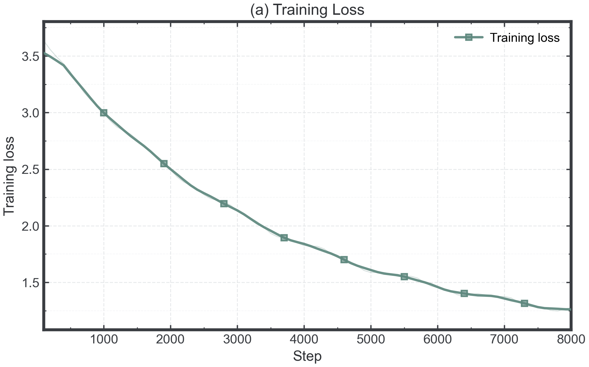
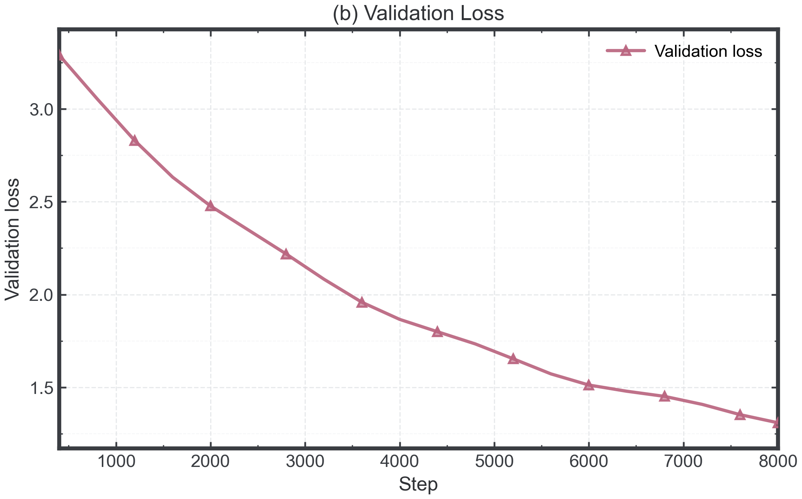
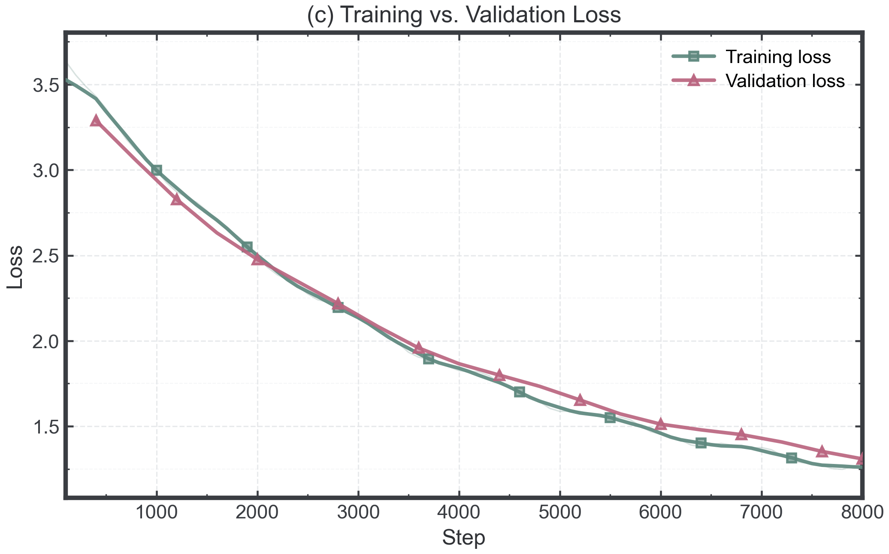
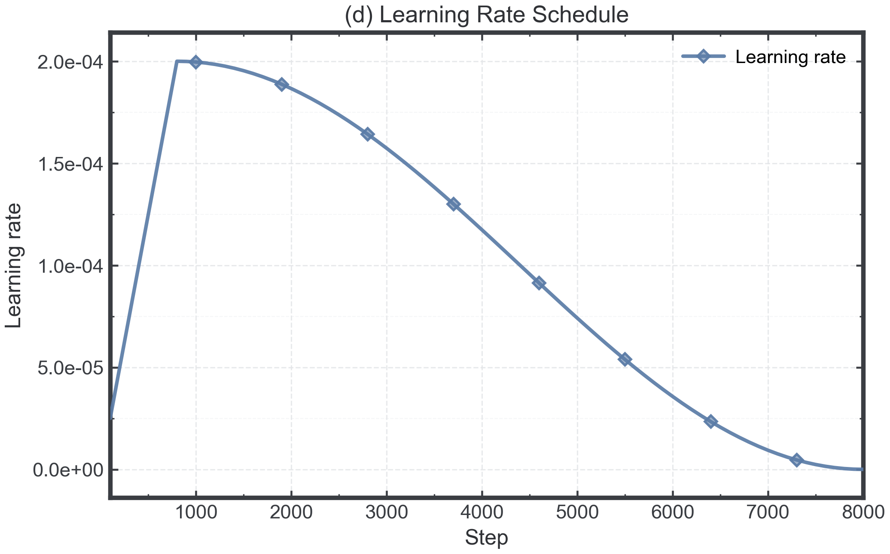
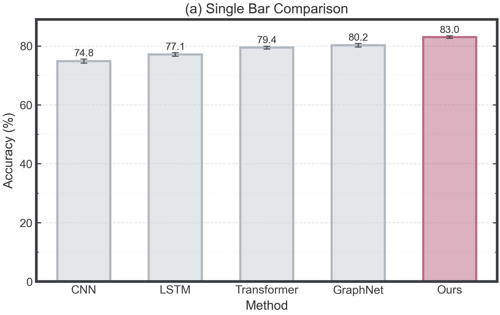
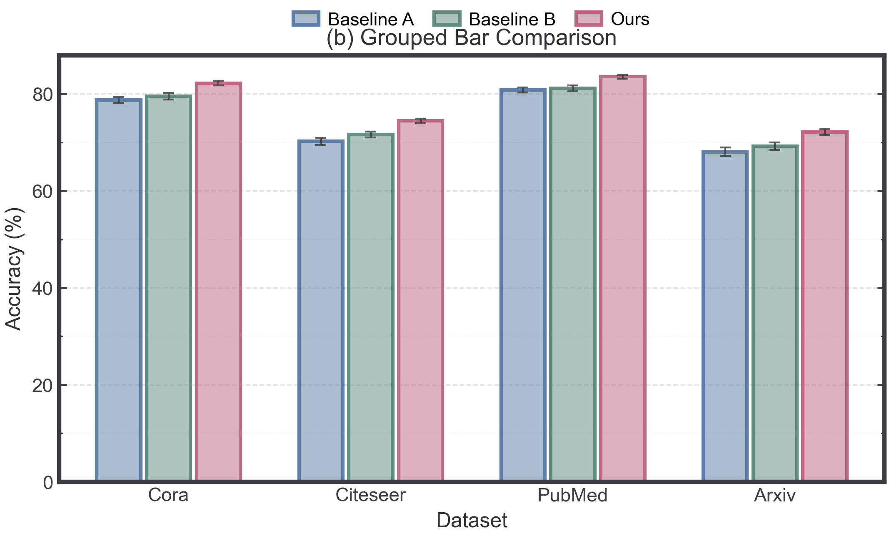
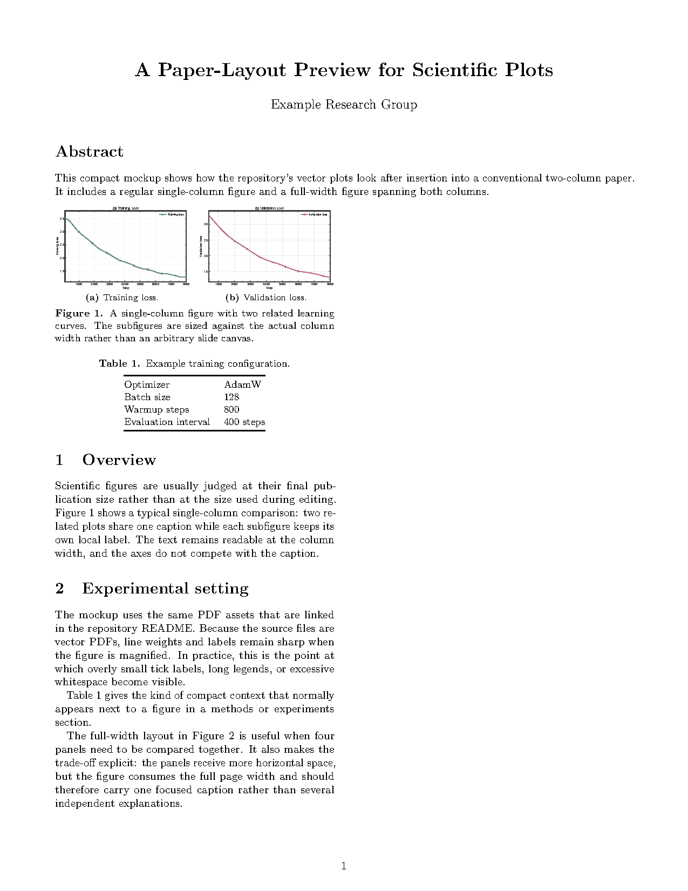
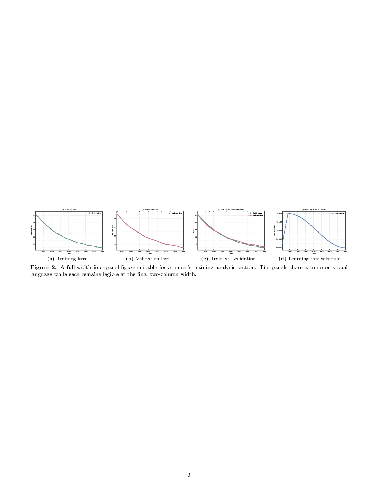

# 我的 Codex Skills

<p align="center">
  <a href="README.md"><strong>English</strong></a>
  ·
  <a href="README.zh-CN.md"><strong>中文</strong></a>
</p>

本仓库包含我的自定义 Codex skills，用于绘制风格统一、可配置、适合科研展示的图表，阅读英文科研论文，以及组织可复现的科研代码项目。

## Skills 列表

### `plot-training-curves`

用于绘制 LLM / 机器学习训练日志曲线，包括：

- 训练损失
- 验证损失
- 训练损失与验证损失对比
- 学习率调度

该 skill 强调可复用绘图代码，要求显式预留 config 接口，用于控制图尺寸、颜色、线型、透明度、marker、标题、坐标轴标签、图例、刻度、网格和导出参数。
默认图表使用完整的 `2.5 pt` 坐标轴边框、`2.0 pt` 主曲线，标记点的边缘也略加粗。
每次出图会在图像旁保存未平滑的完整精度数据、JSON 配置和独立绘图脚本；调整配置后无需原始训练日志即可重绘。

### `plot-bar-charts`

用于绘制科研对比类柱状图，包括：

- 单组柱状图
- 突出某个方法的柱状图
- 分组柱状图
- 误差条与数值标签

该 skill 同样要求生成的柱状图代码预留 config 控制项，包括柱宽、颜色、透明度、边框、误差条、数值标签、图例位置、坐标轴设置和导出格式。
默认图表使用完整的 `2.5 pt` 坐标轴边框和 `2.0 pt` 柱边。
图表数值和误差会单独保存为 CSV，并附带 JSON 配置和独立绘图脚本；重复或缺失的比较项会明确报错，不再静默覆盖。

### `paper-reading`

用于阅读附件中的英文科研论文，并面向具备基础机器学习知识、但不了解论文具体领域的读者，用中文给出有证据依据的分析。该 skill 包括：

- 按 STAR 结构总结背景、任务、方法和结果；
- 结合公式、符号、数据流、训练流程和推理流程还原方法；
- 按论文类型与问题整理实验比较，必要时使用表格；
- 区分观察、假设、算法推导和实验支持；
- 分析局限性、数字或描述不一致、不确定性和结论边界。

它要求关键结论和数字尽可能标注论文中的章节、表格或图号，并区分直接证据、作者推测、合理推断和未报告信息。

完整分析会保存为 `.md` 文件；行内数学使用 `$...$`，独立公式使用 `$$...$$`。后续定向提问默认只在对话中回答，明确要求修订时才更新文件。

### `research-project-architecture`

用于在新建科研 / 机器学习项目、新增实验工作流，以及审查或重构文件架构时安排项目结构，串联复现指南、配置、执行入口、本地资产、实验输出、汇总和可独立重绘的图表。

该 skill 强调按项目规模选择目录层级、统一路径解析、配置校验与临时 CLI 覆盖、运行隔离与增量保存、明确统计口径，以及保存数据 / 配置 / 代码的重绘包。同时区分稳定指南与研究假设，并明确大体积资产和私人笔记的 Git 边界。

新增配置优先使用 `.yaml`；训练进度在合适时使用 `tqdm`，不重要的警告写入运行日志，终端状态使用 `[INFO]`、`[SUCCESS]`、`[WARNING]`、`[FAIL]` 等前缀。绘图通常在训练 / 评测完成后自动执行，也支持修改独立绘图配置后直接使用已保存的数据重绘。

一次实验调用可按 YAML 中的 `seeds` 列表依次运行多个随机种子，分别保存结果，最后以 Markdown、JSON、CSV 同时记录全部单次结果与跨 seed 统计。

内容提炼自真实项目的架构审查，适配已有约定，不强制创建空目录或复制特定算法参数。skill 附带两份按需读取的参考文档和界面元数据，不需要辅助脚本。

## 效果示例

每张预览图都可以点击打开对应的 PDF 文件。

预览图使用示意性合成数据。在安装了 `matplotlib` 和 `numpy` 的 Python 环境中运行 `python3 assets/examples/generate_examples.py` 可重新生成全部预览图。

### 训练曲线

<table>
  <tr>
    <td align="center" width="50%">
      <a href="assets/examples/training_curves/sample_llm_training_curves_a_train_loss.pdf">
        
      </a>
      <br>
      <strong>(a) 训练损失</strong>
    </td>
    <td align="center" width="50%">
      <a href="assets/examples/training_curves/sample_llm_training_curves_b_val_loss.pdf">
        
      </a>
      <br>
      <strong>(b) 验证损失</strong>
    </td>
  </tr>
  <tr>
    <td align="center" width="50%">
      <a href="assets/examples/training_curves/sample_llm_training_curves_c_train_vs_val_loss.pdf">
        
      </a>
      <br>
      <strong>(c) 训练损失与验证损失对比</strong>
    </td>
    <td align="center" width="50%">
      <a href="assets/examples/training_curves/sample_llm_training_curves_d_lr_schedule.pdf">
        
      </a>
      <br>
      <strong>(d) 学习率调度</strong>
    </td>
  </tr>
</table>

### 柱状图

<table>
  <tr>
    <td align="center" width="50%">
      <a href="assets/examples/bar_charts/sample_bar_single.pdf">
        
      </a>
      <br>
      <strong>单组高亮柱状图</strong>
    </td>
    <td align="center" width="50%">
      <a href="assets/examples/bar_charts/sample_bar_grouped.pdf">
        
      </a>
      <br>
      <strong>分组柱状图</strong>
    </td>
  </tr>
</table>

### 论文排版示例

仓库还包含一个两页的论文排版预览：把同一批矢量 PDF 图真正嵌入双栏论文页面，展示单栏两子图、跨双栏的 `figure*` 四子图、子图标签、图注、正文引用，以及图在最终论文尺寸下与周围内容的关系。

<p align="center">
  <a href="assets/examples/paper_layout/paper_layout_demo.pdf">
    
  </a>
  <a href="assets/examples/paper_layout/paper_layout_demo.pdf">
    
  </a>
</p>

源文件位于 [`assets/examples/paper_layout/paper_layout_demo.tex`](assets/examples/paper_layout/paper_layout_demo.tex)。进入该目录后可以运行以下命令重新编译：

```bash
latexmk -pdf paper_layout_demo.tex
```

### 项目架构示例

以一个包含基线、参数扫描和多个随机种子的机器学习研究项目为例，依照该 skill 可以组织成：

```text
research-project/
├── README.md                         # 项目地图与最短启动路径
├── .gitignore
├── pyproject.toml                    # 依赖与实际存在的包信息
├── configs/
│   ├── evaluation/
│   │   ├── baseline.yaml
│   │   ├── method.yaml               # 标准实验
│   │   ├── method_quick.yaml         # 小规模验证，复用同一实现
│   │   └── method_sweep.yaml         # 参数扫描与随机种子
│   └── visualization/
│       └── method_sweep.yaml         # 展示哪些系列、使用什么图表样式
├── guide/
│   ├── preparation.md                # 环境、数据与权重准备
│   └── method_sweep.md               # 协议、验证/正式命令、输出说明
├── scripts/
│   ├── evaluate_method.py            # 多份 method 配置共用的执行入口
│   └── plot_method_sweep.py          # 无需重跑评测即可重新绘图
├── src/research_project/             # 有共享实现需求时再引入
├── tests/                            # 有实际、有效的检查时再创建
├── data/                             # 本地输入，通常不进入 Git
│   ├── downloads/
│   └── raw/<dataset>/
├── models/                           # 本地模型权重，通常不进入 Git
├── runs/                             # 生成的实验产物，通常不进入 Git
│   └── method_sweep/
│       └── idea_selection/           # 实验变体
│           └── run_20261106_120000/  # 每次执行单独保存，避免覆盖
│               ├── resolved_config.yaml
│               ├── run_20261106_120000.log
│               ├── seed_11/
│               │   ├── results.json
│               │   ├── results.csv
│               │   └── results.md
│               ├── seed_42/          # 与 seed_11 相同的结果结构
│               ├── seed_123/
│               └── summary/         # 完成后的跨 seed 汇总
│                   ├── results.json
│                   ├── results.csv
│                   ├── results.md
│                   ├── average_results.json
│                   ├── average_results.csv
│                   ├── average_results.md
│                   └── plots/
│                       ├── comparison_data.csv
│                       ├── comparison_config.yaml
│                       ├── plot_comparison.py
│                       ├── comparison.png
│                       └── comparison.pdf
├── Idea/                             # 可选：带日期的研究假设与计划
└── conversation_w_GPT/               # 可选：实现说明与历史调查记录
```

例如，实验配置可声明以下 seed 顺序。生成的执行脚本依次测试各 seed，分别写入 `seed_<seed>/results.{md,json,csv}`；完成后，将全部单次记录保存为 `summary/results.{md,json,csv}`，并将按实验条件分组的均值及明确定义的标准差保存为 `summary/average_results.{md,json,csv}`。花括号表示分别生成三种格式的文件；以下字段是项目代码需要实现的配置接口示意。

```yaml
seeds: [11, 42, 123]
output_dir: runs/method_sweep
```

参数扫描的文件链是 `guide/method_sweep.md → configs/evaluation/method_sweep.yaml → scripts/evaluate_method.py → runs/method_sweep/...`。各 seed 单独保存结果，汇总时明确聚合方式和不确定性的统计口径；图表目录保留数据、配置与可运行的绘图代码，调整图表样式时无需重复评测。

这个目录树用于示意。小项目可以从 README、一个脚本、一份配置和一个输出目录开始，`src/`、`tests/` 与研究笔记按实际内容添加。小规模验证使用独立临时输出；代码、配置、指南和协议元数据进入 Git，大体积输入与运行产物通常留在本地，私人笔记的忽略方式由项目约定决定。

调用示例：“请用 $research-project-architecture 组织一个包含基线和多 seed 参数扫描的研究项目，提供小规模验证说明、结果汇总，以及可独立重绘的图表产物包。”

## 安装

可以使用 Codex 内置的 GitHub skill installer 安装全部四个 skills：

```bash
python3 "${CODEX_HOME:-$HOME/.codex}/skills/.system/skill-installer/scripts/install-skill-from-github.py" \
  --repo 0917Ray/my-codex-skills \
  --path skills/plot-training-curves skills/plot-bar-charts skills/paper-reading skills/research-project-architecture
```

如果只想安装文献阅读 skill，将同一命令的 `--path` 改为 `skills/paper-reading`。
如果只想安装项目架构 skill，将 `--path` 改为 `skills/research-project-architecture`。

也可以手动复制 skill 文件夹到 Codex 的 skills 目录：

```bash
mkdir -p ~/.codex/skills
cp -R skills/plot-training-curves ~/.codex/skills/
cp -R skills/plot-bar-charts ~/.codex/skills/
cp -R skills/paper-reading ~/.codex/skills/
cp -R skills/research-project-architecture ~/.codex/skills/
```

安装后需要重启 Codex 才能识别新 skills。

使用示例：“请用 $paper-reading 阅读附件论文，按 STAR 结构解释方法，并核查实验是否支持结论。”

项目架构示例：“请用 $research-project-architecture 为这个机器学习实验安排项目结构，并实现配置、运行入口、复现指南和结果保存。”

## 仓库结构

```text
my-codex-skills/
├── skills/
│   ├── plot-training-curves/
│   ├── plot-bar-charts/
│   ├── paper-reading/
│   └── research-project-architecture/
│       ├── SKILL.md
│       ├── agents/openai.yaml
│       └── references/
│           ├── layout-and-docs.md
│           └── experiment-contracts.md
└── assets/
    └── examples/
        ├── bar_charts/
        ├── training_curves/
        ├── paper_layout/
        └── generate_examples.py
```

## 说明

绘图脚本需要 Python 环境中安装 `matplotlib` 和 `numpy`。文献阅读与项目架构 skills 不附带脚本。

绘图 skills 既可以作为可运行工具，也可以作为绘图代码模板。每张图都应保留图表就绪数据、可配置绘图脚本与 JSON 参数，以便调整样式时不再重跑分析。指定 `--output figure.png` 时会生成 `figure_data.csv`、`figure_config.json` 和 `figure_plot.py`；在任何工作目录执行 `python figure_plot.py --config figure_config.json` 即可重绘。
